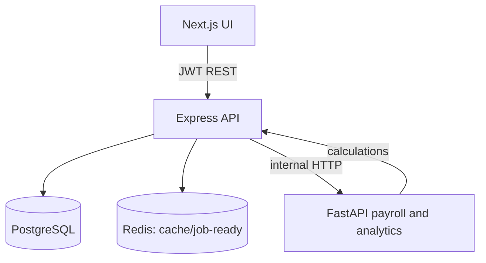

# Architecture

Express owns employee, department, attendance, leave, payroll-run records, reviews, documents metadata and audit logs. FastAPI exposes pure payroll calculations and analytics endpoints using caller-provided datasets; it does not own employee master data. The demo uses synthetic seed data. External integrations are mock adapters (calendar/email/storage/export) unless configured by the operator.

Security boundary: role middleware checks the caller role; salary and payroll routes are HR/payroll/admin restricted. Resource-level manager checks are demo/basic and should be strengthened before production. Authentication uses JWT; passwords are bcrypt hashes. Use HTTPS and rotate secrets in any deployment.
